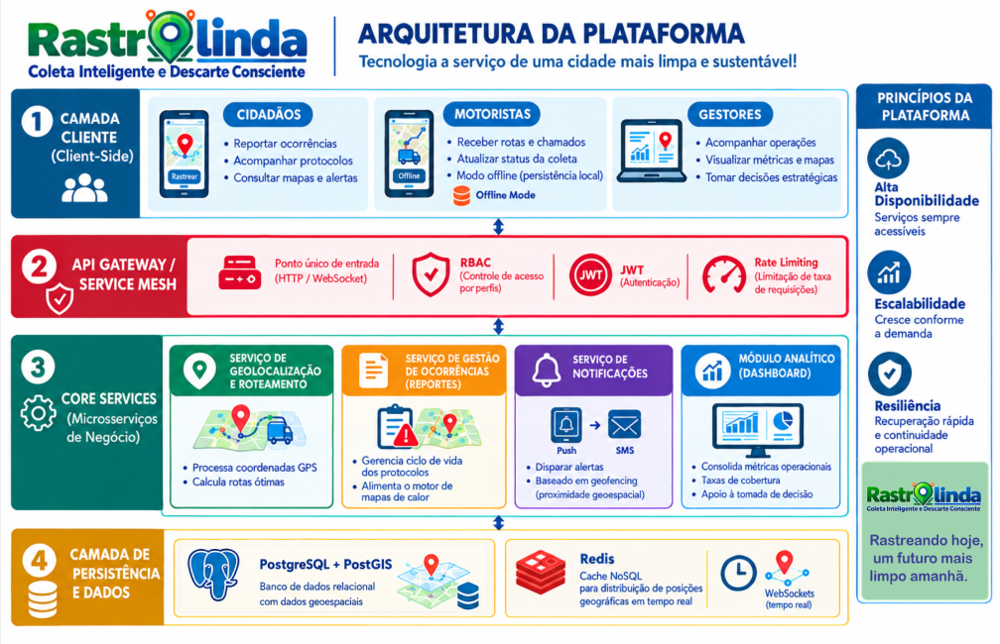
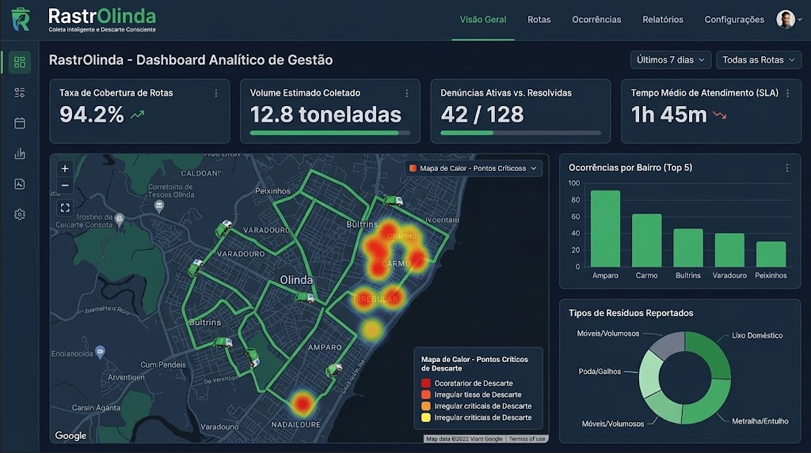
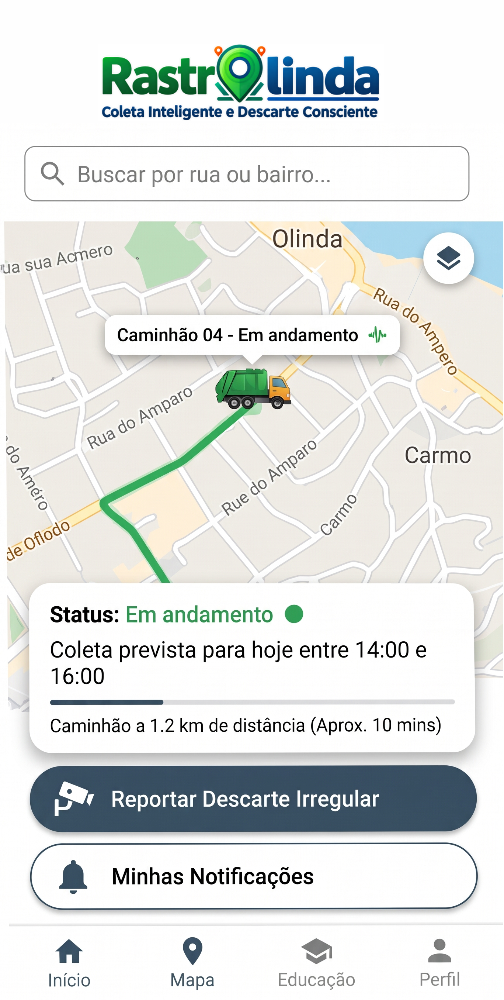
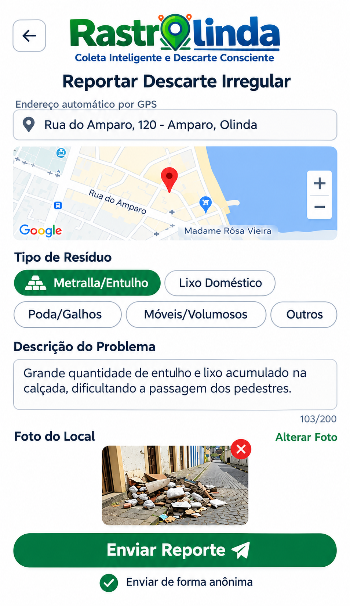

<h1 align="center">♻️ Rota Rastreada (RastrOlinda)</h1>
<p align="center">
  
</p>
<h3 align="center">✨ Feito por <b>Edivone Araújo</b> e <b>Vanessa Taurino</b> ✨</h3>
<p align="center">
  <i><a href="https://desafios.pe.gov.br/challenge?url=rota-rastreada-olinda-coleta-inteligente-e-descarte-consciente">Desafio Rota Rastreada - Desafios.GOV PE</a></i>
</p>

> **Status do Projeto:** 🚧 Em fase de planejamento, especificação de requisitos e modelagem de arquitetura (0% código implementado).

Plataforma de gestão, rastreamento e monitoramento de coleta de resíduos sólidos para o município de **Olinda - PE** (Desafios.GOV PE), projetada para conectar cidadãos, agentes de coleta e gestores públicos com rastreabilidade ponta a ponta, operação *offline-first* e arquitetura de segurança *Zero Trust*.

---

## 📋 Sobre o Projeto

O **Rota Rastreada** visa modernizar a logística urbana de limpeza e coleta de resíduos em Olinda. O sistema permite o acompanhamento em tempo real das rotas dos caminhões coletores, o registro de ocorrências pela população e a auditoria imutável das operações públicas.

Atualmente, o repositório está estruturado para guiar o início do desenvolvimento:
- 📄 **Documento de Especificação de Requisitos (SRS)** concluído (padrão SBC).
- 📌 **15 Issues mapeadas** no backlog do GitHub (User Stories e tarefas técnicas).
- 🏗️ **Arquitetura definida** com foco em resiliência offline, alta disponibilidade e segurança.

---

## 🎯 Escopo e Requisitos Definidos

O projeto baseia-se em **10 Requisitos Funcionais (RF)** e **6 Requisitos Não Funcionais (RNF)** documentados na fase de concepção:

### Requisitos Funcionais (`RF01` – `RF10`)
- **Gestão e Rastreamento de Rotas:** Monitoramento georreferenciado das frotas de coleta em tempo real e consulta de cronogramas por bairro.
- **Portal do Cidadão:** Abertura de chamados/ocorrências (descarte irregular, pontos críticos, coleta não realizada) com geolocalização e evidência fotográfica.
- **Operação de Campo (Coletor):** Check-in de início/fim de rota, registro de pontos coletados e reporte de impedimentos nas vias.
- **Painel de Gestão Pública:** Dashboard analítico com indicadores de desempenho, cumprimento de metas, mapas de calor e relatórios gerenciais.
- **Notificações e Alertas:** Avisos de proximidade da coleta para moradores e alertas de desvio de rota para gestores.

### Requisitos Não Funcionais (`RNF01` – `RNF06`)
| Código | Requisito | Diretriz Arquitetural |
| :--- | :--- | :--- |
| **RNF01** | **Multiplataforma** | Acesso responsivo via Web (gestão/cidadão) e Mobile/PWA (operação em campo). |
| **RNF02** | **Conformidade com a LGPD** | Anonimização de dados sensíveis do cidadão, gestão de consentimento e controle de acesso granular. |
| **RNF03** | **Modo Offline e Sincronização** | Persistência local via **SQLite** no dispositivo do coletor com sincronização assíncrona automática ao recuperar conexão. |
| **RNF04** | **Desempenho em Tempo Real** | Transmissão de telemetria GPS de baixa latência utilizando **WebSockets**. |
| **RNF05** | **Rastreabilidade e Auditoria** | Trilha de auditoria imutável registrando todas as alterações críticas de rotas, chamados e logs operacionais. |
| **RNF06** | **Segurança Zero Trust** | Autenticação contínua, verificação explícita em cada requisição de API e princípio do menor privilégio. |

---

## 🏗️ Visão Geral da Arquitetura
<p align="center">
  
</p>
A arquitetura foi projetada em camadas desacopladas para garantir escalabilidade e resiliência em áreas com instabilidade de sinal móvel:

- **Camada de Apresentação:** Interfaces web e mobile responsivas para os perfis *Cidadão*, *Agente Coletor* e *Gestor Municipal*.
- **Camada de Comunicação & Tempo Real:** APIs RESTful protegidas por políticas *Zero Trust* + canal bidirecional via **WebSockets** para telemetria ao vivo.
- **Camada de Persistência Híbrida:**
  - **Nuvem (Central):** Banco de dados relacional (**MySQL / PostgreSQL**) para dados estruturados, georreferenciamento e trilhas de auditoria.
  - **Borda (Local/Offline):** Banco **SQLite** embarcado para fila de eventos offline e resolução de conflitos na sincronização.

---

## 🗺️ Roadmap de Desenvolvimento

- [x] Levantamento de requisitos e criação da Matriz CSD e Personas
- [x] Especificação dos 10 Requisitos Funcionais (`RF01`–`RF10`) e 6 Requisitos Não Funcionais (`RNF01`–`RNF06`)
- [x] Definição da arquitetura (*Zero Trust*, *WebSockets* e *Offline SQLite*)
- [x] Criação das 15 *Issues* iniciais no GitHub Projects
- [ ] Setup do repositório, ambiente de desenvolvimento e banco de dados
- [ ] Implementação do módulo de autenticação e segurança (*Zero Trust*)
- [ ] Desenvolvimento do núcleo de rastreamento via *WebSockets*
- [ ] Implementação da sincronização *offline-first* (`SQLite` ↔ Servidor)
- [ ] Testes integrados e validação dos critérios de aceite

---

## 📌 Organização do Backlog (Issues)

As **15 issues** cadastradas na aba [Issues](../../issues) deste repositório representam as *User Stories* e entregas técnicas derivadas diretamente dos requisitos `RF01` a `RF10` e `RNF01` a `RNF06`.

Para acompanhar o progresso, consulte o quadro **Projects** vinculado ao repositório.

---

## 📂 Estrutura Planejada do Repositório

```text
rota-rastreada/
├── docs/                  # Documentação de requisitos (LaTeX/PDF), diagramas e protótipos
├── backend/               # API REST, WebSockets e regras de negócio (a implementar)
├── frontend/              # Aplicação Web / Painel do Gestor e Cidadão (a implementar)
├── mobile/                # App de campo com suporte offline SQLite (a implementar)
└── README.md              # Visão geral do projeto
```

---
## 🎨 Protótipos e Visão das Interfaces

### Painel Analítico de Gestão (Web)
<p align="center">
  
</p>

### Aplicativo do Cidadão (Mobile / PWA)

<div align="center">

| Rastreamento em Tempo Real | Reporte de Descarte Irregular |
| :---: | :---: |
|  |  |

</div>

---

## 📄 Licença

Este projeto está em desenvolvimento e será distribuído sob a licença MIT. Consulte o arquivo LICENSE para mais informações.

---
## 👨‍💻 Autoras

Edivone Araújo e Vanessa Taurino

💬 Desenvolvido para prática de Engenharia de Requisitos

📧 Contatos:

<p align="center">
  <a href="https://www.linkedin.com/in/edivone-araujo"></a>
  &nbsp;&nbsp;&nbsp;
  <a href="https://github.com/EdivoneAraujo"></a>
</p>

<p align="center">
  <a href="https://www.linkedin.com/in/edilka-vanessa-menezes-taurino"></a>
  &nbsp;&nbsp;&nbsp;
  <a href="https://github.com/nessataurino-design"></a>
</p>

---
🏁 Licença
Este projeto é licenciado sob a MIT License.
Sinta-se livre para estudar!

---

